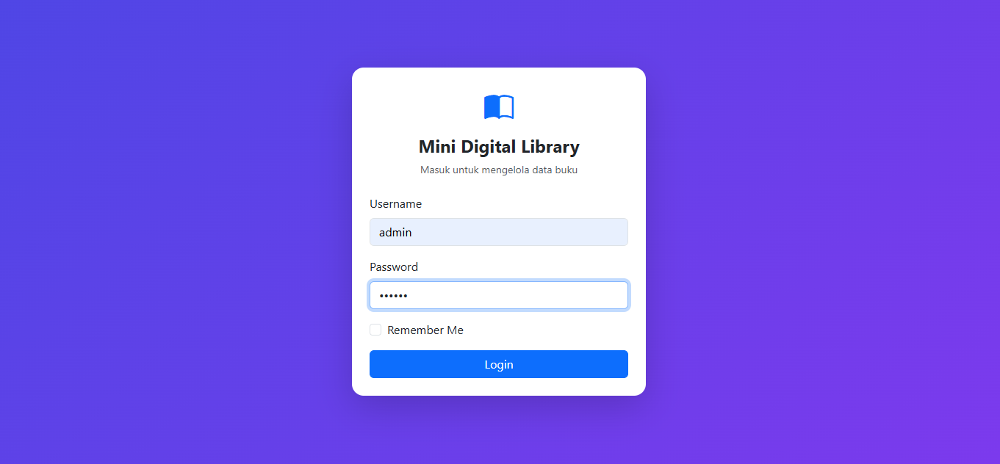
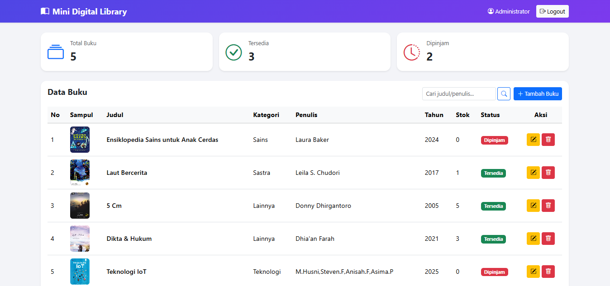
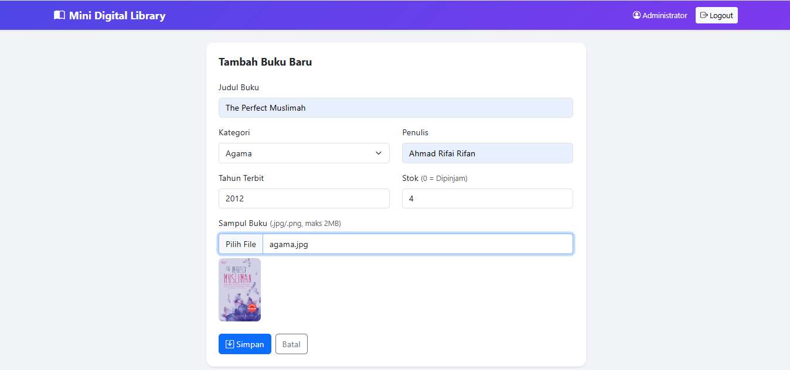
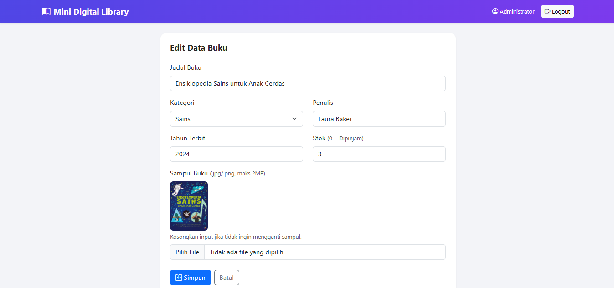
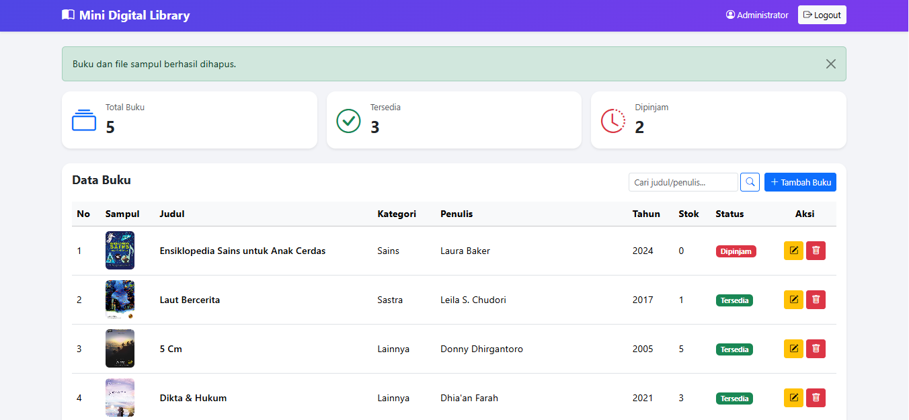
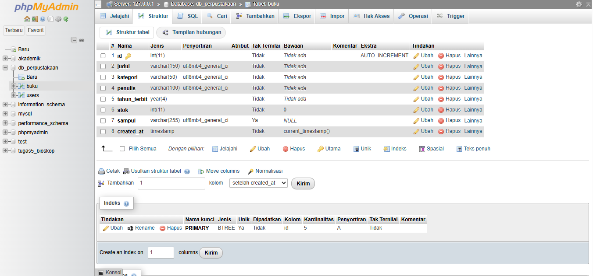
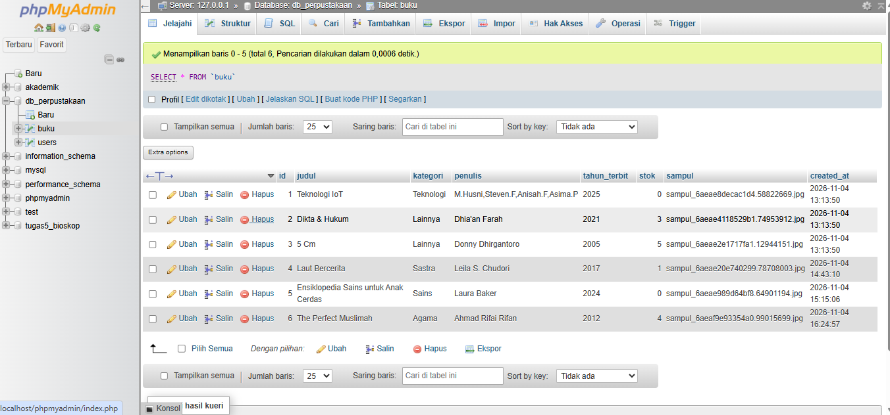

# Mini Digital Library

Tugas Terstruktur Pemrograman Web: aplikasi pengelolaan data buku (CRUD) dengan autentikasi, session, cookie, dan upload file sampul. Dibuat dengan **PHP Native** + **MySQL (mysqli)** + **Bootstrap 5**.

## Fitur
- **Login** (POST) dengan password ter-hash (`password_hash` / `password_verify`) dan `session_regenerate_id`
- **Session**: Dashboard dan semua halaman kelola buku hanya bisa diakses setelah login
- **Cookie "Remember Me"**: menyimpan username di browser selama 30 hari
- **Logout**: menghapus session dan cookie, lalu redirect ke halaman login
- **CRUD Buku** dengan prepared statement
- **Upload sampul**: validasi ekstensi (.jpg/.png), isi file asli gambar, dan ukuran maks 2MB. File lama otomatis dihapus saat sampul diganti atau buku dihapus
- **Logika status**: `stok > 0` = *Tersedia*, `stok = 0` = *Dipinjam* (percabangan if-else)
- Tambahan: pencarian, kartu statistik, proteksi CSRF pada form tambah/edit/hapus, preview gambar sebelum upload

## Struktur Project
```
project_perpustakaan/
├── config/
│   ├── koneksi.php        # Koneksi database
│   ├── auth.php           # Pengecekan session + token CSRF
│   ├── fungsi.php         # Fungsi bantu: upload, validasi, label status
│   ├── header.php         # Layout atas (navbar, CSS)
│   ├── footer.php         # Layout bawah (JS)
│   └── form_buku.php      # Form bersama tambah & edit
├── uploads/               # Penampung sampul buku
├── index.php              # Halaman login
├── proses_login.php       # Verifikasi login, session, cookie
├── logout.php             # Hapus session & cookie
├── dashboard.php          # Read: tabel data buku
├── tambah_buku.php        # Form tambah
├── proses_tambah.php      # Insert + upload
├── edit_buku.php          # Form edit
├── proses_edit.php        # Update + ganti file
├── hapus_buku.php         # Delete + unlink file
└── db_perpustakaan.sql    # Ekspor database
```

## Cara Menjalankan
1. Install XAMPP/Laragon, aktifkan **Apache** dan **MySQL**.
2. Salin folder project ke `htdocs` (XAMPP) atau `www` (Laragon).
3. Buka phpMyAdmin, **Import** file `db_perpustakaan.sql`.
4. Sesuaikan kredensial database di `config/koneksi.php` bila perlu.
5. Buka `http://localhost/project_perpustakaan/`.

**Akun default:** username `admin`, password `admin123`

## Struktur Tabel Database

### Tabel `users`
| Kolom | Tipe | Keterangan |
|---|---|---|
| id | INT, AUTO_INCREMENT | Primary key |
| username | VARCHAR(50) | Unik |
| password | VARCHAR(255) | Hash bcrypt |
| nama_lengkap | VARCHAR(100) | Nama tampilan |

### Tabel `buku`
| Kolom | Tipe | Keterangan |
|---|---|---|
| id | INT, AUTO_INCREMENT | Primary key |
| judul | VARCHAR(150) | Judul buku |
| kategori | VARCHAR(50) | Kategori |
| penulis | VARCHAR(100) | Penulis |
| tahun_terbit | YEAR | Tahun terbit |
| stok | INT | 0 = Dipinjam, >0 = Tersedia |
| sampul | VARCHAR(255) | Nama file di folder `uploads/` |
| created_at | TIMESTAMP | Waktu input |

## Screenshot
> Ganti file gambar di folder `screenshots/` dengan screenshot aplikasi kamu.

| Halaman | Screenshot |
|---|---|
| Login |  |
| Dashboard (Read) |  |
| Tambah Buku (Create) |  |
| Edit Buku (Update) |  |
| Hapus Buku (Delete) |  |
| Struktur Database Buku  |  |
| Database Buku  |  |

## Video Demo
[Tonton di YouTube](https://youtu.be/jfDw4okRqhg?si=gRHYZKaKNmmoNIo_)

## Identitas
- Nama: Titania
- NPM: 2513020080
- Kelas: 2A Sistem Informasi, Universitas Nusantara PGRI Kediri
